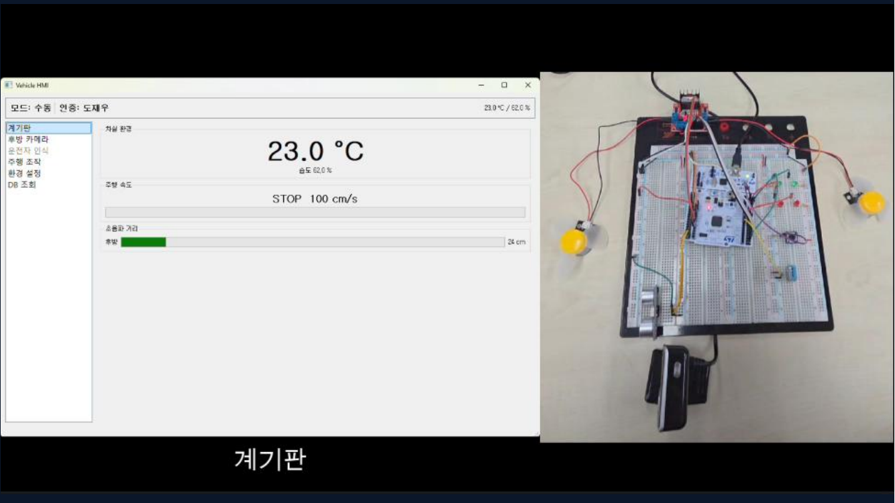
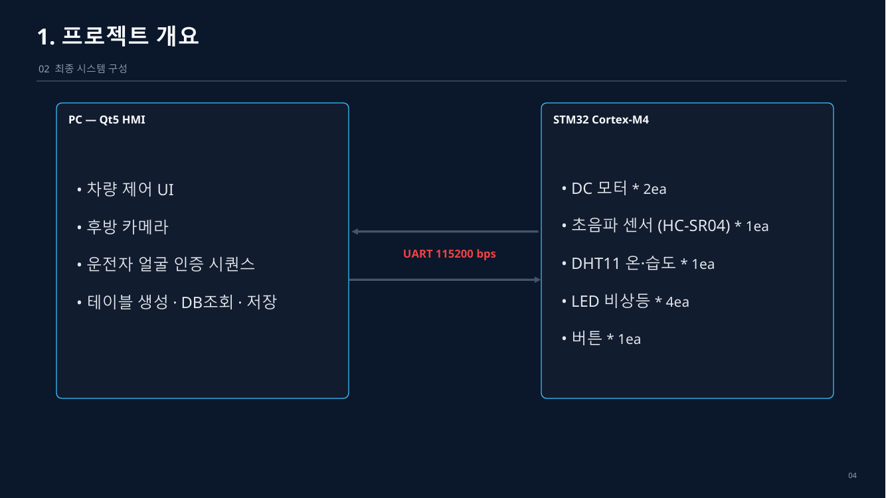
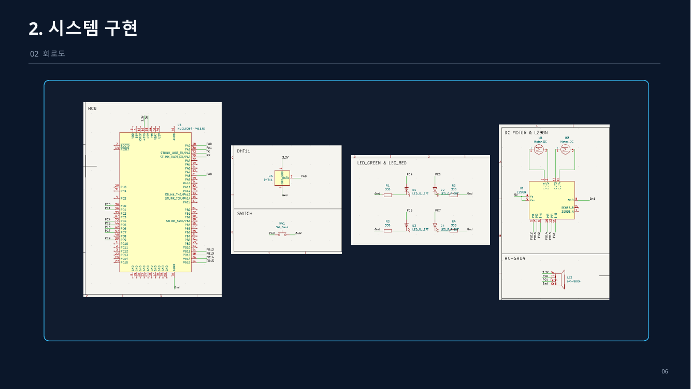
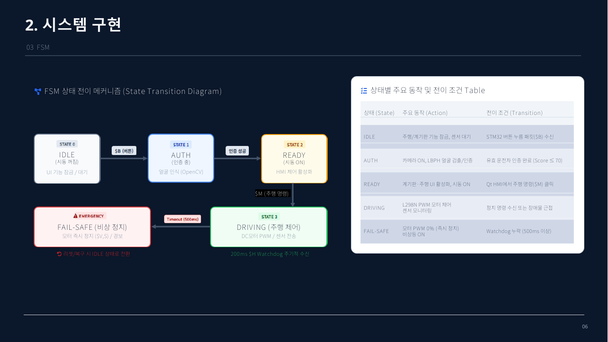
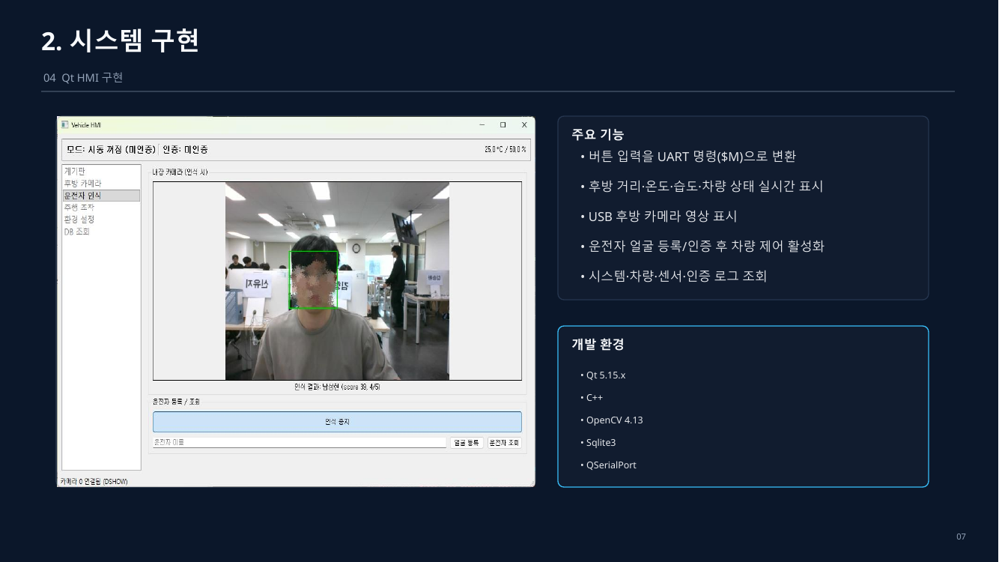

# 🚗 Qt-STM32 HMI Project — 자동차 HMI 모사 시스템

> **STM32 Cortex-M4 펌웨어 + Qt5 HMI**를 UART로 연결해 주행 제어, 센서 모니터링, 후방 카메라, 운전자 얼굴 인증, DB 로깅을 하나의 차량 HMI 흐름으로 통합한 프로젝트입니다.
> *AI 시스템반도체 SW개발자 2기 (대한상공회의소) · 2팀*



## ✨ 주요 기능

| 구분 | 내용 |
|---|---|
| 주행 제어 | Qt에서 전진/후진/좌회전/우회전/정지 명령 → STM32가 L298N으로 DC 모터 2개 구동 |
| 센서 모니터링 | HC-SR04 후방 거리, DHT11 온·습도를 주기 전송하여 Qt UI·DB에 반영 |
| 비상등 | LED 4개 ON/OFF 제어 |
| 운전자 인증 | 차량 버튼(`$B`) → Qt 얼굴 인증(Haar 검출 + LBPH 인식, 5회 연속 일치) 후 주행 UI 잠금 해제 |
| Fail-safe | Qt 하트비트(`$H`, 200ms)가 500ms 이상 끊기면 모터 강제 정지 + `$V,S` 전송 |
| 데이터 로깅 | SQLite에 시스템 이벤트, 주행, 센서, 운전자, 인증 로그 저장 |

## 🧩 시스템 구성



| PC (Qt 5.15 / C++) | STM32 NUCLEO-F411RE (Cortex-M4F) |
|---|---|
| 차량 제어 UI, 후방 카메라(OpenCV 4.13) | DC 모터 ×2 (L298N), 초음파 HC-SR04 ×1 |
| 얼굴 등록·인증, SQLite 테이블 생성/조회/저장 | DHT11 온·습도 ×1, LED ×4, 버튼 ×1 |
| `QSerialPort` 기반 통신 | 레지스터 직접 제어 (`device_driver.h` + `macro.h`) |

> 이 저장소는 위 구성 중 **STM32 펌웨어** 부분입니다. Qt 측 구조는 아래 보고서 요약을 참고하세요.

### 하드웨어 / 핀맵



### 상태 머신 (Qt HMI)



| 상태 | 동작 | 전이 조건 |
|---|---|---|
| IDLE | 주행/계기판 잠금 | 버튼 패킷(`$B`) 수신 |
| AUTH | 카메라 ON, 얼굴 검출/인증 | 유효 운전자 인증 (score ≤ 70) |
| READY | 계기판·주행 UI 활성 | 주행 명령(`$M`) |
| DRIVING | PWM 모터 제어, 센서 모니터링 | 정지 명령 또는 장애물 근접 |
| FAIL-SAFE | 모터 즉시 정지, 비상등 ON | 하트비트 500ms 이상 누락 |



## 🔌 UART 프로토콜 (115200, 8-N-1, `\n` 종료)

| 방향 | 패킷 | 설명 |
|---|---|---|
| STM32 → Qt | `$V,<F\|B\|L\|R\|S>` | 주행 상태 변경 이벤트 |
| STM32 → Qt | `$D,<온도>,<습도>,<거리>,<속도>` | 500ms 주기 센서 데이터 |
| STM32 → Qt | `$B` | 버튼 눌림 (인증 요청) |
| Qt → STM32 | `$M,<F\|B\|L\|R\|S>` | 수동 주행 명령 |
| Qt → STM32 | `$E,<0\|1>` | 비상등 |
| Qt → STM32 | `$H` | 하트비트 (200ms) |

## 🛠 트러블슈팅 하이라이트

| 문제 | 원인 | 해결 |
|---|---|---|
| 일부 모터가 배선·코드 정상인데 동작 안 함 | PB13~15가 연결된 Arduino 헤더(D11~D13)가 F411RE에서 기본 미연결 (숨은 솔더브릿지) | Morpho 헤더의 PB13~15에 직결 |
| 카메라 중복 Open 실패 | 표시·인식 스레드가 각각 카메라를 열어 DirectShow 충돌 | CaptureThread 한 곳에서만 Open 후 최신 프레임 공유 |
| 워커 스레드에서 DB 저장 시 연결 제약 | `QSqlDatabase` 스레드 제약 | 결과를 시그널로 UI 스레드에 전달해 DB 쓰기 일원화 |
| 인증 흐름 혼란 | 버튼과 동시에 인식하면 신규 운전자 등록 불가 | 버튼을 "인증 자동 시작"이 아닌 "탑승 이벤트 + 인증 기능 활성화"로 분리 |

## 📈 결과와 향후 과제

- STM32 단독 제어에서 확장해 **PC·센서·카메라·DB가 연동되는 통합 시스템 구조**를 확보했습니다.
- 향후: 가변 PWM 속도 제어, 전·후·좌·우 초음파 확장, Face Embedding 기반 인증 개선, 운전자 세션 관리, 자율 주행 모드

## ⚙️ 빌드

```bash
make          # 빌드
make run      # STM32CubeProgrammer로 다운로드
make clean    # 정리
```

- 툴체인: `arm-none-eabi-gcc`, 타깃: STM32F411RE (96MHz, FPU 사용)

## 📁 문서

- [결과 보고서 (PDF)](docs/AI_시스템반도체_SW개발자_2기_결과보고서%282팀%29.pdf) · [회로 CAD (PDF)](docs/HMI_Project_CAD.pdf)

---

# 📎 펌웨어 개발 노트 (상세)

## QT-STM-Prj — 차량 제어 시스템 (인터럽트 전면 적용)

수업에서 배운 두 프로젝트(`MOTOR_CONTROL_PROJECT`, `TIMER_EVENT_LAB`)의 스타일을 그대로 따라
**처음부터 다시 짠** 펌웨어입니다. `device_driver.h` + `macro.h` 구조를 쓰고,
**시간이 걸리는 모든 작업을 타이머 인터럽트 + 플래그로 처리해 블로킹 대기를 전부 없앴습니다.**

- **보드**: NUCLEO-F411RE (STM32F411RE, Cortex-M4F)
- **방식**: 레지스터 직접 제어, `macro.h` 매크로 사용
- **통신**: USART2 (ST-Link 가상 COM), 115200-8-N-1, 유선
- **빌드**: 기존 Makefile 그대로 (`make`)

---

### 1. 이번 버전에서 지킨 원칙

> "TIM_Delay()도 내부에 while이 있어서 멈추는 거잖아. 멈추지 않게 짤 수 있잖아."

이 기준을 코드 전체에 그대로 적용했습니다.

| 작업 | 예전 방식 (블로킹) | 이번 방식 |
|---|---|---|
| 디바운싱 | `TIM4_Delay(20)` 후 재확인 | EXTI 인터럽트 + 1ms 틱 비교 |
| DHT11 시작 신호 18ms | `while` 폴링으로 대기 | 1ms 틱 기준 상태머신 (다른 일 계속 처리) |
| DHT11 40비트 수신 | 매 비트마다 `while` 폴링 | **EXTI 엣지 인터럽트**로 완전히 비동기 처리 |
| 초음파 Echo 대기 | `while` 폴링 | EXTI 인터럽트 |
| 페일세이프 타임아웃 | - | 1ms 틱 비교 (블로킹 없음) |

메인 루프(`main.c`)에는 시간 대기 목적의 `while`이 단 한 줄도 없습니다.

<details>
<summary>예외: 아주 짧은(10us) 하드웨어 셋업 펄스</summary>

초음파 Trig 10us 펄스 한 곳만 `Tick_Spin_Us()`로 짧게 스핀합니다. 이건
"이 프로그램을 일정 시간 멈추는" 지연이 아니라 **신호 하나를 만드는 데
필요한 하드웨어 프로토콜 요구사항**이라 성격이 다릅니다 (사람이 체감할
수 없는 마이크로초 단위이고, 앱 로직을 조금도 지연시키지 않습니다).
</details>

---

### 2. 파일 구성

수업 예제 중 `TIMER_EVENT_LAB`처럼 **개별 모듈 헤더 없이 `device_driver.h` 하나로 통일**했습니다.
모든 `.c` 파일은 `#include "device_driver.h"` 하나만 있습니다.

| 파일 | 역할 |
|---|---|
| `device_driver.h` | 전체 모듈의 extern 선언 모음 (직접 작성) |
| `macro.h` | 비트 조작 매크로 (**그대로 재사용**) |
| `option.h` | 클럭 상수 (**재사용**) |
| `clock.c` | 클럭 초기화 (전압 스케일링 추가, 4장 참조) |
| `uart.c` | USART2/1 송수신 (**재사용 + RX 인터럽트 함수 추가**) |
| `timer.c` | TIM4 1ms 틱 + TIM3 1us 카운터 |
| `motor.c` | 바퀴 2개 (L298N) |
| `led.c` | LED 4개 (Green/Red 각 2개) |
| `sonar.c` | 초음파 1개 (EXTI 인터럽트) |
| `dht11.c` | 온습도 (EXTI 인터럽트 상태머신) |
| `button.c` | 외부 버튼 (EXTI 인터럽트 + 디바운스, 진단 로그 포함) |
| `comm.c` | Qt 프로토콜 (링버퍼 + 파싱) |
| `main.c` | 정책 로직 전체 (정적 함수 + 조건문) |
| `exception.c` | 인터럽트 핸들러 모음 |
| `crt0.s`, `rom_0x08000000.lds`, CMSIS 헤더들, `runtime.c`, `system_stm32f4xx.*` | **수업 파일 그대로 재사용** |

---

### 3. 핀 배치

| 기능 | 핀 | 비고 |
|---|---|---|
| Qt 통신 TX/RX | PA2 / PA3 | USART2, 재사용 |
| 좌 바퀴 PWM | PA0 | TIM5_CH1 → L298N ENA |
| 우 바퀴 PWM | PA1 | TIM5_CH2 → L298N ENB |
| 좌 바퀴 방향 | PB12 / PB13 | L298N IN1 / IN2 |
| 우 바퀴 방향 | PB14 / PB15 | L298N IN3 / IN4 |
| LED Green Left | PC4 | |
| LED Green Right | PC5 | |
| LED Red Left | PC6 | |
| LED Red Right | PC7 | |
| 초음파 Trig | PC0 | |
| 초음파 Echo | PC1 | EXTI1, **5V→3.3V 분압 필수** |
| DHT11 DATA | PA8 | EXTI8, 오픈드레인 |
| 버튼 | PC9 | EXTI9, **외부 배선용** (온보드 아님) |

**EXTI9_5 그룹을 DHT11(EXTI8)과 버튼(EXTI9)이 공유**합니다. 핀 번호가 다르므로
같은 인터럽트 벡터 안에서 `EXTI->PR` 비트로 구분해 처리하며 충돌 없습니다.

---

### 4. 데이터시트 근거로 추가/수정한 것

#### 전압 스케일링 (clock.c)

RM0383 기준 VOS 리셋 기본값(Scale 2)은 최대 84MHz까지입니다. 96MHz로 올리려면
Scale 1(0b11)로 바꿔야 하고, 이 비트는 PLL이 꺼져 있을 때만 바꿀 수 있어서
PLL을 켜기 **전에** 처리합니다. 원본 `MOTOR_CONTROL_PROJECT`의 `clock.c`에는
이 설정이 없었습니다.

#### DHT11 타이밍

첨부해주신 번역 데이터시트 기준 그대로 구현했습니다.

| 항목 | 값 |
|---|---|
| 시작 신호 | 최소 18ms Low |
| 센서 응답 | Low 80us → High 80us |
| 비트 0 | Low 50us + High 26~28us |
| 비트 1 | Low 50us + High 70us |
| 측정 간격 | 최소 1초 (본 코드는 2.5초 사용) |

---

### 5. 설계에서 신경 쓴 부분

#### DHT11을 EXTI 상태머신으로 (이번 버전의 핵심)

18ms 시작 신호는 1ms 틱 기준으로 진행하고, 그 이후 응답과 40비트 데이터는
**전부 EXTI 엣지 인터럽트**로 받습니다. 엣지가 들어올 때마다 상태를 한 칸씩
진행시키고, TIM3 마이크로초 카운터로 직전 엣지와의 시간差를 재서 비트를 판정합니다.

```c
// dht11.c 상태머신 핵심부
case DHT_BIT_HIGH:
    bit_val = (elapsed > s_low_ref_us) ? 1 : 0;  // High가 Low보다 길면 1
    ...
```

고정 임계값(예: 45us) 대신 **직전 Low 구간과 비교**하는 방식이라, 클럭 오차나
인터럽트 지연이 양쪽에 똑같이 실려 자동으로 상쇄됩니다.

#### 정책 로직은 main.c에

말씀하신 대로 함수 포인터·이벤트 테이블 같은 별도 추상화 없이, `On_Drive_Cmd`·
`On_Hazard_Cmd`·`Check_Failsafe` 같은 정적 함수들을 main.c 안에
직접 두고 조건문으로 호출합니다. `MOTOR_CONTROL_PROJECT`의 `main.c` 구조
(`Sys_Init`, `On_Uart_Input` 같은 정적 함수 + `for(;;)` 안 조건문)를 그대로 따랐습니다.

---

### 6. 통신 프로토콜

#### STM32 → Qt

```
$V,<F|B|L|R|S>\n              주행 상태 변경 시 (이벤트)
$D,<온도>,<습도>,<거리>,<속도>\n   500ms 주기
$B\n                          버튼 눌림 (이벤트)

예)
$V,F                차가 전진으로 바뀜
$D,24.6,52.3,120,100 온도 24.6도, 습도 52.3%, 거리 120cm, 속도 100%(고정값)
```

#### Qt → STM32

```
$M,<F|B|L|R|S>\n   수동 주행 명령
$E,<0|1>\n         비상등
$H\n               하트비트 (200ms 주기 권장)
```

#### Qt 팀에 전달할 사항

1. **하트비트를 200ms마다 보내세요.** 500ms간 수신이 없으면 STM32가 강제로
   정지 상태로 돌아가고 `$V,S`를 보냅니다.
2. **수신은 개행 기준으로 버퍼링하세요.** 한 번의 `readyRead`로 한 줄이
   통째로 오지 않습니다.
3. **`$`로 시작하지 않는 줄은 무시하세요.** 부팅 메시지가 같은 포트로 나갑니다.
4. **`$V`는 상태가 바뀔 때만 옵니다.** 주기적으로 오는 게 아니라
   이벤트성이니, Qt 쪽에서 마지막 값을 캐싱해두는 방식으로 UI를 구성하세요.

---

### 7. 배선 주의사항

**다이오드 없으면 역기전력으로 트랜지스터가 파괴됩니다.**

#### 초음파 Echo — 5V를 3.3V로

```
Echo ──[1kΩ]──┬── PC1
              │
            [2kΩ]
              │
             GND
```

#### DHT11 — 풀업 저항

데이터시트 권장 5kΩ 풀업을 DATA 핀에 연결하세요. 모듈에 이미 달려있는
경우가 많으니 확인하시고, 없으면 추가하세요. (내부 풀업도 보조로 켜뒀지만
외부 풀업이 정석입니다.)

#### 버튼 — 외부 배선

**Nucleo 온보드 버튼이 아닙니다.** PC9와 GND 사이에 버튼을 연결하세요.
내부 풀업을 켜뒀으니 추가 저항 없이도 동작하지만, 이미 회로에 풀업/풀다운을
넣으셨다면 그대로 두셔도 됩니다.

#### 전원

- 모터 전원과 MCU 전원을 **반드시 분리**, GND만 공통
- 모터 전원단에 470uF 커패시터

---

### 8. 빌드

```bash
make          # 빌드
make run      # STM32CubeProgrammer로 다운로드
make clean    # 정리
```

Makefile의 `TOOL_DIR`은 원래 쓰시던 경로 그대로 뒀습니다.

---

### 8-1. Tera Term 수동 테스트 (Qt 없이)

Qt 쪽 코드가 아직 없어서 혼자 확인해봐야 할 때를 위한 모드입니다.

```
$X,1      먼저 이거 한 번 (페일세이프 해제)
$R,0      화면이 계속 밀리면 이거 (주기 $D 보고 끄기)
$M,F      전진
$M,S      정지
$E,1      비상등
$R,1      값 변화를 다시 보고 싶으면 (주기 $D 보고 켜기)
$X,0      테스트 끝났으면 이거 (페일세이프 복귀)
```

<callout>

**`$X`, `$R` 둘 다 Tera Term 수동 테스트 전용입니다.** Qt 쪽에는 이 두
명령이 없어야 합니다. 통신 담당자에게 프로토콜 전달할 때 이 부분은
빼고 알려주세요.

**왜 필요한가**
- `$X,1` — 페일세이프는 Qt가 200ms마다 하트비트(`$H`)를 계속 보내는 걸
  전제로 짰습니다. 사람이 손으로 타이핑하면 명령 하나 치고 결과를 보는
  그 순간 500ms가 지나 자동으로 정지해버립니다.
- `$R,0` — 주기 `$D` 패킷이 500ms마다 계속 들어오면 입력 중인 줄이
  자꾸 밀려서 타이핑이 힘듭니다. 명령 입력할 때만 잠깐 꺼두세요.

</callout>

부팅하면 콘솔에 명령 목록이 자동으로 뜹니다. 타이핑한 글자가 화면에
안 보이면 Tera Term의 **Setup → Terminal → Local echo**를 켜세요
(로컬 에코는 터미널 설정이라 펌웨어와 무관합니다).

명령을 보내면 즉시 `[RX] M,F` 같은 확인 메시지가 뜨고, 상태가 실제로
바뀌면 `$V,F` 같은 프로토콜 패킷도 같이 옵니다. 둘 다 안 뜨면
보드가 명령을 아예 못 받은 것이니 보레이트(115200)나 배선을 확인하세요.

---

### 9. 단계별 검증 순서

전부 만들고 한 번에 켜면 어디가 문제인지 알 수 없습니다. **반드시 하나씩** 확인하세요.

#### 1단계 — 부팅과 통신

Tera Term 등으로 115200 접속. 부팅 메시지와 `$D` 패킷이 0.5초마다 보이면
클럭·타이머·UART가 전부 정상입니다.

#### 2단계 — 모터 + LED

```
$M,F   → 전진, GL+GR 켜짐
$M,B   → 후진, RL+RR 켜짐
$M,L   → 좌회전, 왼쪽 GL+RL 이 같이 깜빡임
$M,S   → 정지, 전부 꺼짐
$E,1   → 비상등, 4개 전부 깜빡임
```

바퀴 방향이 반대면 L298N IN 배선을 바꾸거나 `motor.c`의 `Wheel_Set()` 안
Set/Clear를 뒤집으세요.

#### 3단계 — 초음파

`$D` 패킷 3번째 필드. 손을 대면 값이 줄어야 합니다.

#### 4단계 — DHT11

`$D` 패킷 1·2번째 필드. 손으로 감싸면 온도가 올라가야 합니다.
계속 25.0/50.0(초기값)이면 읽기가 실패하는 중입니다 — 풀업 저항을 확인하세요.

#### 5단계 — 버튼

```
버튼 누름 → Tera Term에 [BTN] edge processed... 로그가 뜬다
          → 이어서 [BTN] press detected -> sending $B 가 뜬다
          → $B 패킷이 실제로 나간다
```

**`[BTN] edge processed` 자체가 안 뜨면 EXTI 인터럽트가 아예 안 걸리는
것** — PC9 배선, GND 공통 연결을 확인하세요. 이 로그는 뜨는데
`press detected`가 안 뜨면 디바운스/풀업 쪽 문제이니 알려주세요.

> **여기까지 되면 Qt 없이 전체 기능이 검증된 상태입니다.**

#### 6단계 — Qt 연동

그 다음에 붙입니다.

---

### 10. 자주 걸리는 함정

| 증상 | 원인 | 해결 |
|---|---|---|
| 부팅 메시지조차 안 나옴 | 클럭 설정 실패 | VOS·플래시 대기 순서 확인 |
| 모터 켜면 보드 재부팅 | 전원 공용 | 전원 분리, GND만 공통 |
| 거리값이 계속 999 | Echo 배선 또는 EXTI 미설정 | 분압 저항, SYSCFG 클럭 확인 |
| 온도가 계속 25.0 | DHT11 풀업 없음 또는 배선 | 5k 풀업 확인, PA8 배선 확인 |
| 버튼 눌러도 `[BTN]` 로그 자체가 안 뜸 | EXTI 인터럽트 미발생 | PC9 배선, GND 공통, 풀업 확인 (11장 참조) |
| `[BTN]`은 뜨는데 `$B`가 안 감 | UART 송신 문제 | 다른 프로토콜 명령도 안 되는지 확인 |
| 주행 중 갑자기 멈춤 | Qt 하트비트 누락 | 200ms마다 `$H` 전송 확인 |
| DHT11이 가끔 실패 | 정상적인 현상 | `Dht11_Get_Fail_Count()`로 확인. 가끔 실패는 정상, 값은 유지됨 |

---

### 11. 버튼이 반응 없을 때 — 배선 체크리스트

`[BTN] edge processed` 로그 자체가 안 뜨는 경우, 순서대로 확인하세요.

1. **PC9가 진짜 Morpho 커넥터의 그 핀인지** — PC9는 Arduino 호환 헤더가
   아니라 **Morpho 커넥터(CN7/CN10, 긴 2줄 헤더)에만 나옵니다.** Arduino
   모양 헤더에서 찾고 계셨다면 애초에 다른 핀을 만지고 있었을 수 있습니다
2. **버튼 배선** — 버튼 한쪽을 PC9에, 다른 쪽을 GND에. 내부 풀업을
   켜뒀으므로 추가 저항 없이 이 두 선만 연결하면 됩니다
3. **GND 공통** — 버튼의 GND가 Nucleo GND와 실제로 이어져 있는지
   (브레드보드 레일을 나눠 쓰고 계시다면 특히 확인)
4. **버튼 자체 확인** — 멀티미터로 버튼 양단 저항을 재서, 누르면
   0Ω(도통) 되는지 확인

1~3번이 대부분입니다. 다 확인했는데도 `[BTN]` 로그가 안 뜨면 알려주세요.

---

### 12. 발표에서 강조할 점

1. **모든 시간 대기를 인터럽트로 전환** — DHT11까지 포함해서 블로킹 `while`
   폴링을 완전히 제거. 특히 DHT11의 EXTI 엣지 기반 상태머신은 대부분의
   예제 코드가 폴링으로 처리하는 부분을 인터럽트로 바꾼 것이라 설명할 거리가 됩니다.

2. **데이터시트 기반 클럭 설정** — 96MHz 동작을 위한 전압 스케일링.
   원본 예제에는 없던 부분을 직접 찾아 추가한 것입니다.
