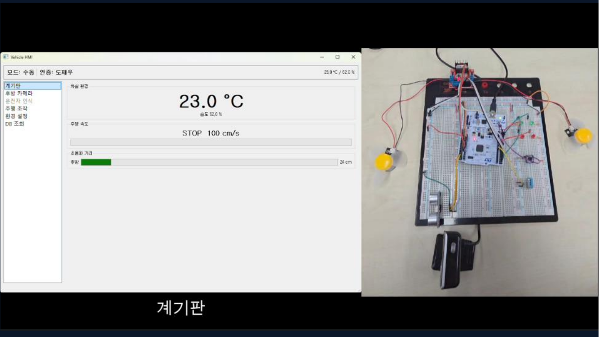
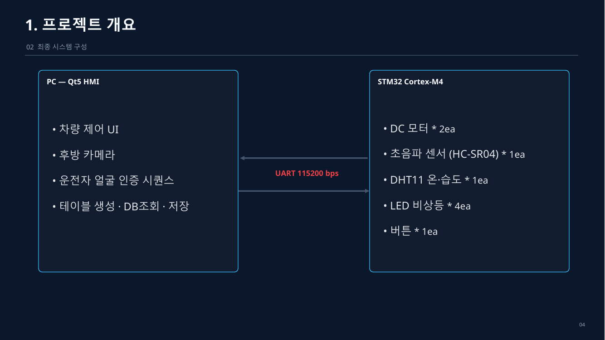
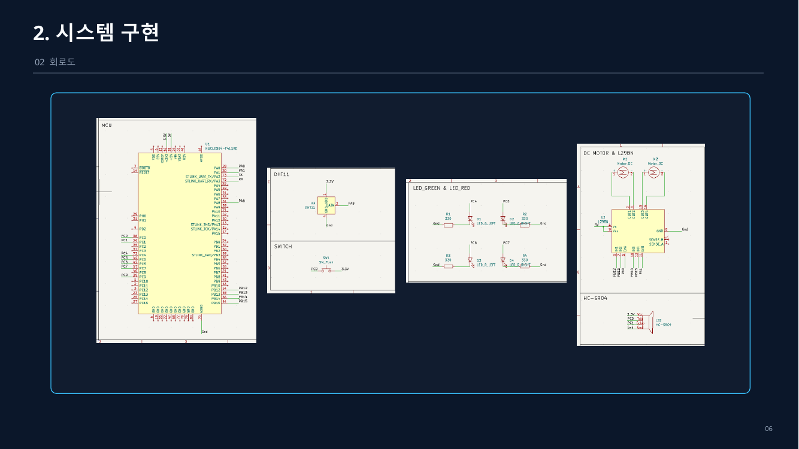
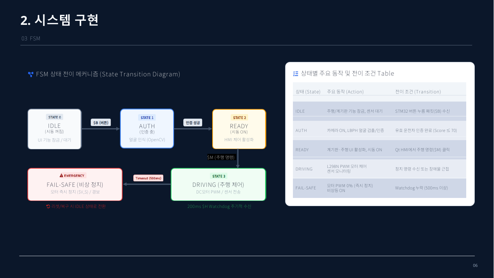
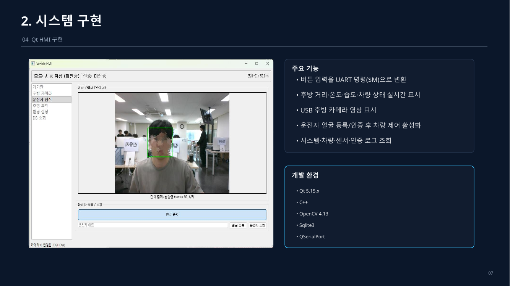

# 🚗 Qt-STM32 HMI Project — 자동차 HMI 모사 시스템

> **STM32 Cortex-M4 펌웨어 + Qt5 HMI**를 UART로 연결해 주행 제어, 센서 모니터링, 후방 카메라, 운전자 얼굴 인증, DB 로깅을 하나의 차량 HMI 흐름으로 통합한 프로젝트입니다.
> *AI 시스템반도체 SW개발자 2기 (대한상공회의소) · 2팀*



## ✨ 주요 기능

| 구분 | 내용 |
|---|---|
| 주행 제어 | Qt에서 전진/후진/좌회전/우회전/정지 명령 → STM32가 L298N으로 DC 모터 2개 구동 |
| 센서 모니터링 | HC-SR04 후방 거리, DHT11 온·습도를 주기 전송하여 Qt UI·DB에 반영 |
| 비상등 | LED 4개 ON/OFF 제어 |
| 운전자 인증 | 차량 버튼(`$B`) → Qt 얼굴 인증(Haar 검출 + LBPH 인식, 5회 연속 일치) 후 주행 UI 잠금 해제 |
| Fail-safe | Qt 하트비트(`$H`, 200ms)가 500ms 이상 끊기면 모터 강제 정지 + `$V,S` 전송 |
| 데이터 로깅 | SQLite에 시스템 이벤트, 주행, 센서, 운전자, 인증 로그 저장 |

## 🧩 시스템 구성



| PC (Qt 5.15 / C++) | STM32 NUCLEO-F411RE (Cortex-M4F) |
|---|---|
| 차량 제어 UI, 후방 카메라(OpenCV 4.13) | DC 모터 ×2 (L298N), 초음파 HC-SR04 ×1 |
| 얼굴 등록·인증, SQLite 테이블 생성/조회/저장 | DHT11 온·습도 ×1, LED ×4, 버튼 ×1 |
| `QSerialPort` 기반 통신 | 레지스터 직접 제어 (`device_driver.h` + `macro.h`) |

> 이 저장소는 위 구성 중 **STM32 펌웨어** 부분입니다. Qt(PC) 쪽 소스는 팀원 저장소 [Kevin-jwd/HMI-qt](https://github.com/Kevin-jwd/HMI-qt)에 있으며, 구조는 아래 [Qt HMI 구현](#-qt-hmi-pc-구현) 에 정리했습니다.

### 하드웨어 / 핀맵



### 상태 머신 (Qt HMI)



| 상태 | 동작 | 전이 조건 |
|---|---|---|
| IDLE | 주행/계기판 잠금 | 버튼 패킷(`$B`) 수신 |
| AUTH | 카메라 ON, 얼굴 검출/인증 | 유효 운전자 인증 (score ≤ 70) |
| READY | 계기판·주행 UI 활성 | 주행 명령(`$M`) |
| DRIVING | PWM 모터 제어, 센서 모니터링 | 정지 명령 또는 장애물 근접 |
| FAIL-SAFE | 모터 즉시 정지, 비상등 ON | 하트비트 500ms 이상 누락 |



## 🔌 UART 프로토콜 (115200, 8-N-1, `\n` 종료)

| 방향 | 패킷 | 설명 |
|---|---|---|
| STM32 → Qt | `$V,<F\|B\|L\|R\|S>` | 주행 상태 변경 이벤트 |
| STM32 → Qt | `$D,<온도>,<습도>,<거리>,<속도>` | 500ms 주기 센서 데이터 |
| STM32 → Qt | `$B` | 버튼 눌림 (인증 요청) |
| Qt → STM32 | `$M,<F\|B\|L\|R\|S>` | 수동 주행 명령 |
| Qt → STM32 | `$E,<0\|1>` | 비상등 |
| Qt → STM32 | `$H` | 하트비트 (200ms) |

## 🖥 Qt HMI (PC) 구현

> 팀원이 맡은 PC 쪽 구현입니다. 소스: [`qt/`](qt/) (원본: [Kevin-jwd/HMI-qt](https://github.com/Kevin-jwd/HMI-qt)) · 개발 환경: C++17, Qt 5.15(Widgets·SerialPort·Sql), OpenCV 4.x + contrib, SQLite, qmake + MinGW-w64(MSYS2 UCRT64)

### 화면 구성 (6개)

| 화면 | 내용 |
|---|---|
| 계기판 | 차실 온습도, 주행 속도, 후방 초음파 거리 |
| 후방 카메라 | USB 카메라 영상, 후방 거리 표시 |
| 운전자 인식 | 내장 카메라 영상, 얼굴 등록·인증, 운전자 조회 |
| 주행 조작 | 방향 버튼, 비상등 |
| 환경 설정 | 선풍기 상태, 임계 온도 |
| DB 조회 | 기간·종류별 로그 조회 |

### 동작 시나리오

```
프로그램 실행     운전자 인식 화면만 활성, 카메라 정지
      │
      ▼
STM32 버튼 ($B)   탑승 신호 → 인식·등록 버튼 잠금 해제
      │
      ▼
[인식 시작]       카메라 기동 → 얼굴 검출·인식
      │
      ▼
인증 확정         5회 연속 동일 인물일 때만 확정
      │
      ▼
계기판 화면       전체 화면 잠금 해제, 주행 조작 가능
```

인증 전에는 운전자 인식 탭 외의 모든 화면이 잠기고, 인증이 끝나면 반대로 인식 탭이 잠깁니다.

### 소프트웨어 구조

```
MainWindow ─ UI 배선 · 인증 상태 관리 · DB 저장
   ├─ SerialLink ─────── STM32 프로토콜 파싱 · 송신 · 200ms 하트비트
   ├─ DatabaseManager ── SQLite 연결 · 스키마 · 저장 · 조회
   ├─ CaptureThread ──┬─ DisplayThread ────→ 영상 표시
   │  (카메라 1대당 1개) └─ RecognitionThread ─→ 검출 · 인식 루프
   └─ FaceEngine ─────── Haar 검출 + LBPH 인식 연산
```

| 설계 원칙 | 이유 |
|---|---|
| 카메라 1대당 `CaptureThread` 1개, 소비자(표시·인식)를 여러 개 연결 | DirectShow는 같은 장치를 두 번 열면 실패 |
| DB 접근은 UI 스레드에서만, 워커는 시그널로 전달 | `QSqlDatabase` 커넥션은 생성한 스레드에서만 사용 가능 |
| 스레드 종료는 소비자 → 생산자 순서 | 해제된 객체를 소비자가 참조하는 것을 방지 |

### 얼굴 인증 파이프라인

| 단계 | 처리 |
|---|---|
| 검출 | Haar Cascade로 얼굴 위치(사각형)를 찾음 — 등록 여부와 무관 |
| 정규화 | 얼굴 영역만 잘라 200×200 흑백으로 통일, `equalizeHist`로 밝기 보정 |
| 인식 | LBPH로 등록된 운전자와 비교, 거리값(score)이 낮을수록 유사 (기준 ≤ 70) |
| 확정 | 5회 연속 동일 인물일 때만 인증 (오인식 방지) |
| 등록 | 운전자당 20장 샘플 저장, 등록·삭제 시 전체 재학습 |

### 데이터베이스 (SQLite, 6개 테이블) — [`db/`](db/)

| 테이블 | 내용 |
|---|---|
| `system_event` | 시스템·카메라·통신·얼굴 이벤트 |
| `vehicle_log` | 주행 방향, 속도, 후방 거리 (방향 변경 또는 속도 5 이상 변화 시에만 저장) |
| `sensor_log` | 온·습도, FAN 상태 (500ms 수신, DB에는 최대 1초 간격 기록) |
| `driver` | 등록된 운전자 |
| `face_sample` | 얼굴 샘플 경로 (`driver` 삭제 시 연쇄 삭제) |
| `auth_log` | 인증 이력과 판정값 (`driver` 삭제 시 이력은 보존) |

얼굴 이미지는 DB에 넣지 않고 파일로 저장하며 경로만 기록합니다.

### 펌웨어와의 연동 참고

- Qt는 공조 제어 `$F`와 공조 상태 `$C` 메시지도 정의해 두었지만, **이 펌웨어에는 구현되어 있지 않습니다.** 수신한 알 수 없는 명령은 무시하므로 동작에는 영향이 없습니다.
- 현재 Qt UI에서 STM32로 보내는 주행 명령은 좌·우회전(`$M,L`/`$M,R`)이며, 전진·후진·정지 버튼은 아직 연결되지 않았습니다. 펌웨어는 `F/B/L/R/S`를 모두 처리합니다.
- Qt가 하트비트를 끊으면 STM32가 500ms 뒤 안전 정지에 들어가므로, 통신이 끊긴 상태에서 마지막 주행 명령이 유지되지 않습니다.

## 🛠 트러블슈팅 하이라이트

| 문제 | 원인 | 해결 |
|---|---|---|
| 일부 모터가 배선·코드 정상인데 동작 안 함 | PB13~15가 연결된 Arduino 헤더(D11~D13)가 F411RE에서 기본 미연결 (숨은 솔더브릿지) | Morpho 헤더의 PB13~15에 직결 |
| 카메라 중복 Open 실패 | 표시·인식 스레드가 각각 카메라를 열어 DirectShow 충돌 | CaptureThread 한 곳에서만 Open 후 최신 프레임 공유 |
| 워커 스레드에서 DB 저장 시 연결 제약 | `QSqlDatabase` 스레드 제약 | 결과를 시그널로 UI 스레드에 전달해 DB 쓰기 일원화 |
| 인증 흐름 혼란 | 버튼과 동시에 인식하면 신규 운전자 등록 불가 | 버튼을 "인증 자동 시작"이 아닌 "탑승 이벤트 + 인증 기능 활성화"로 분리 |

## 📈 결과와 향후 과제

- STM32 단독 제어에서 확장해 **PC·센서·카메라·DB가 연동되는 통합 시스템 구조**를 확보했습니다.
- 향후: 가변 PWM 속도 제어, 전·후·좌·우 초음파 확장, Face Embedding 기반 인증 개선, 운전자 세션 관리, 자율 주행 모드

## ⚙️ 빌드

```bash
cd stm32
make          # 빌드
make run      # STM32CubeProgrammer로 다운로드
make clean    # 정리
```

- 툴체인: `arm-none-eabi-gcc`, 타깃: STM32F411RE (96MHz, FPU 사용)

## 📂 저장소 구조

```
.
├── stm32/   STM32F411RE 펌웨어 (C, Makefile)
├── qt/      Qt HMI 소스 (C++/Qt 5.15, OpenCV) + 설치·얼굴인식 문서
├── db/      SQLite 스키마(schema.sql)와 DB 설계 문서
└── docs/    결과 보고서, 회로 CAD, README 이미지
```

## 📁 문서

- [결과 보고서 (PDF)](docs/AI_시스템반도체_SW개발자_2기_결과보고서%282팀%29.pdf) · [회로 CAD (PDF)](docs/HMI_Project_CAD.pdf)

---

# 📎 펌웨어 설계 노트 (STM32F411RE)

- **보드**: NUCLEO-F411RE (STM32F411RE, Cortex-M4F, 96MHz) · **방식**: 레지스터 직접 제어 (`device_driver.h` + `macro.h`)
- **통신**: USART2 (ST-Link 가상 COM), 115200-8-N-1 · **빌드**: `arm-none-eabi-gcc` + Makefile

### 1. 설계 원칙 — 메인 루프에서 기다리지 않기

시간이 걸리는 모든 작업을 **타이머 인터럽트 + 플래그**로 처리해, `main.c`의 메인 루프에는 시간 대기용 `while`이 없습니다.

| 작업 | 이전 방식 (블로킹) | 변경 후 |
|---|---|---|
| 버튼 디바운싱 | `TIM4_Delay(20)` 후 재확인 | EXTI 인터럽트 + 1ms 틱 비교 |
| DHT11 시작 신호 18ms | `while` 폴링 대기 | 1ms 틱 기준 상태머신 |
| DHT11 40비트 수신 | 비트마다 `while` 폴링 | **EXTI 엣지 인터럽트**로 비동기 처리 |
| 초음파 Echo 대기 | `while` 폴링 | EXTI 인터럽트 |
| 페일세이프 타임아웃 | – | 1ms 틱 비교 |

> 예외: 초음파 Trig 10us 펄스 한 곳만 `Tick_Spin_Us()`로 짧게 대기합니다. 프로그램을 멈추는 지연이 아니라 센서 규격상 펄스 하나를 만드는 데 필요한 시간입니다.

정책 로직(`On_Drive_Cmd`, `On_Hazard_Cmd`, `Check_Failsafe` 등)은 별도 추상화 없이 `main.c`의 정적 함수와 조건문으로 두었습니다.

### 2. 파일 구성

| 파일 | 역할 |
|---|---|
| `device_driver.h` | 전체 모듈의 extern 선언 모음 |
| `macro.h`, `option.h` | 비트 조작 매크로, 클럭 상수 (수업 코드 재사용) |
| `clock.c` | 클럭 초기화 (**전압 스케일링 추가**) |
| `uart.c` | USART2 송수신 (+ RX 인터럽트) |
| `timer.c` | TIM4 1ms 틱, TIM3 1us 카운터 |
| `motor.c` | 바퀴 2개 (L298N, TIM5 PWM, 스키드 조향) |
| `led.c` | LED 4개 (Green/Red 각 2개) |
| `sonar.c` | 초음파 (EXTI) |
| `dht11.c` | 온습도 (EXTI 엣지 상태머신) |
| `button.c` | 외부 버튼 (EXTI + 디바운스, 진단 로그) |
| `comm.c` | Qt 프로토콜 (링버퍼 + 파싱) |
| `main.c` | 정책 로직 |
| `exception.c` | 인터럽트 핸들러 |
| `crt0.s`, `rom_0x08000000.lds`, CMSIS, `runtime.c`, `system_stm32f4xx.*` | 수업 제공 시작 코드·링커·헤더 |

### 3. 핀 배치

| 기능 | 핀 | 비고 |
|---|---|---|
| Qt 통신 TX/RX | PA2 / PA3 | USART2 |
| 좌/우 바퀴 PWM | PA0 / PA1 | TIM5_CH1/CH2 → L298N ENA/ENB |
| 좌 바퀴 방향 | PB12 / PB13 | L298N IN1 / IN2 |
| 우 바퀴 방향 | PB14 / PB15 | L298N IN3 / IN4 (Morpho 헤더 직결) |
| LED (G-L, G-R, R-L, R-R) | PC4 / PC5 / PC6 / PC7 | |
| 초음파 Trig / Echo | PC0 / PC1 | Echo는 EXTI1, **5V→3.3V 분압** |
| DHT11 DATA | PA8 | EXTI8, 오픈드레인 |
| 버튼 | PC9 | EXTI9, 외부 배선 (Morpho 헤더) |

DHT11(EXTI8)과 버튼(EXTI9)은 같은 `EXTI9_5` 벡터를 공유하며, 핸들러에서 `EXTI->PR` 비트로 구분합니다.

### 4. 데이터시트 근거로 추가한 설정

- **전압 스케일링 (RM0383)**: VOS 리셋 기본값(Scale 2)은 최대 84MHz까지 보장합니다. 96MHz 동작을 위해 PLL을 켜기 **전에** VOS를 Scale 1로 바꾸고, 플래시 대기 시간(3WS)을 설정합니다. 수업 예제 `clock.c`에는 없던 설정입니다.
- **DHT11 타이밍**

| 항목 | 값 |
|---|---|
| 시작 신호 | 최소 18ms Low |
| 센서 응답 | Low 80us → High 80us |
| 비트 0 / 1 | Low 50us + High 26~28us / Low 50us + High 70us |
| 측정 간격 | 최소 1초 (본 코드는 2.5초) |

### 5. DHT11 EXTI 상태머신

18ms 시작 신호는 1ms 틱으로 진행하고, 응답과 40비트 데이터는 **EXTI 엣지 인터럽트**마다 상태를 한 칸씩 진행합니다. TIM3 1us 카운터로 직전 엣지와의 간격을 잽니다.

```
RELEASE → ACK_FALL → ACK_LOW → ACK_HIGH → (BIT_LOW → BIT_HIGH) × 40 → DONE / ERROR
```

```c
// dht11.c - 비트 판정
case DHT_BIT_HIGH:
    bit_val = (elapsed > s_low_ref_us) ? 1 : 0;  // High가 직전 Low보다 길면 1
```

고정 임계값(예: 45us) 대신 **직전 Low 구간과 비교**하므로 클럭 오차나 인터럽트 지연이 양쪽에 같이 실려 상쇄됩니다. 체크섬이 맞지 않거나 6ms 안에 다음 엣지가 오지 않으면 ERROR로 처리하고 이전 값을 유지합니다.

### 6. Qt 연동 규칙

- Qt는 하트비트 `$H`를 **200ms마다** 보냅니다. 500ms간 수신이 없으면 STM32가 정지 상태로 전환하고 `$V,S`를 보냅니다.
- 수신은 **개행 기준으로 버퍼링**합니다 (`readyRead` 한 번에 한 줄이 통째로 오지 않음).
- `$`로 시작하지 않는 줄(부팅 메시지 등)은 무시합니다.
- `$V`는 상태가 바뀔 때만 오는 이벤트이므로 Qt는 마지막 값을 캐싱해 UI를 구성합니다.

### 7. 배선 주의사항

- **초음파 Echo 분압**: `Echo ─[1kΩ]─┬─ PC1`, `┴─[2kΩ]─ GND` (5V → 약 3.3V)
- **DHT11 풀업**: DATA 핀에 5kΩ 외부 풀업 (내부 풀업은 보조)
- **버튼**: PC9와 GND 사이 연결, 내부 풀업 사용 (온보드 버튼 아님)
- **전원**: 모터 전원과 MCU 전원을 분리하고 GND만 공통, 모터 전원단에 470uF 커패시터

### 8. Qt 없이 단독 검증

Qt 연동 전에 Tera Term으로 펌웨어를 단계별로 확인하기 위해 **테스트 전용 명령**을 두었습니다 (Qt 프로토콜에는 포함하지 않음).

| 명령 | 용도 |
|---|---|
| `$X,1` / `$X,0` | 페일세이프 해제 / 복귀 (수동 입력은 200ms 하트비트를 보낼 수 없으므로) |
| `$R,0` / `$R,1` | 500ms 주기 `$D` 보고 끄기 / 켜기 (입력 중 화면 밀림 방지) |

| 단계 | 확인 방법 | 정상 기준 |
|---|---|---|
| 1. 부팅·통신 | 115200 접속 | 부팅 메시지와 `$D`가 0.5초마다 출력 |
| 2. 모터·LED | `$M,F` `$M,B` `$M,L` `$M,S` `$E,1` | 방향별 바퀴 회전, LED 패턴 |
| 3. 초음파 | `$D` 3번째 필드 | 손을 대면 값 감소 |
| 4. DHT11 | `$D` 1·2번째 필드 | 손으로 감싸면 온도 상승 |
| 5. 버튼 | 버튼 누름 | `[BTN] edge processed` → `$B` 전송 |
| 6. Qt 연동 | Qt 실행 | 인증 → 주행 → 하트비트 유지 |

### 9. 자주 생기는 문제

| 증상 | 원인 | 확인 / 해결 |
|---|---|---|
| 부팅 메시지가 안 나옴 | 클럭 설정 실패 | VOS·플래시 대기 순서 |
| 모터를 켜면 보드 재부팅 | 모터·MCU 전원 공용 | 전원 분리, GND만 공통 |
| 거리값이 계속 999 | Echo 배선 또는 EXTI 미설정 | 분압 저항, SYSCFG 클럭 |
| 온도가 계속 25.0(초기값) | DHT11 풀업 없음 / 배선 | 5kΩ 풀업, PA8 배선 |
| 버튼 로그가 안 뜸 | EXTI 미발생 | PC9가 Morpho 헤더 핀인지, GND 공통, 멀티미터로 도통 |
| 주행 중 갑자기 정지 | 하트비트 누락 (정상 동작) | Qt의 200ms `$H` 송신 |
